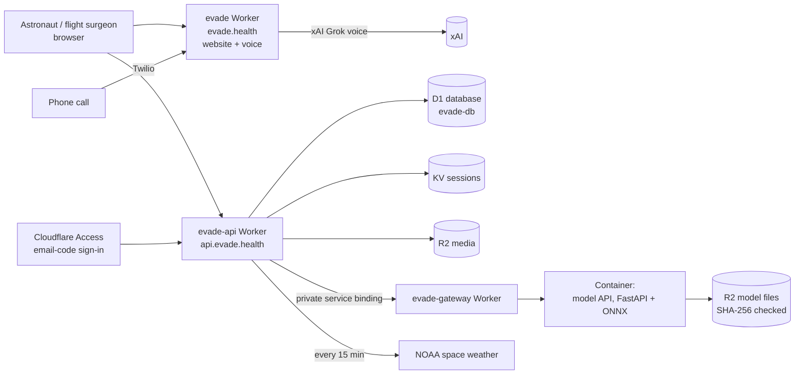

# 🛰️ EVAde

### Health monitoring for astronauts on long-duration missions

**NASA Space Apps Challenge 2026 · NYU Tandon · Team EVAde**

*EVA (spacewalk) + evade: dodge the hazards of deep space.*

**[Open the live app → evade.health](https://evade.health)**

> **The challenge:** Long missions expose astronauts to radiation, isolation, altered gravity and a closed environment, which can cause bone loss, heart and immune changes, poor sleep and behavioral-health problems. Astronauts have to notice these changes themselves. Build software that gathers health indicators and helps them evaluate and act on their health.

**EVAde is our answer:** astronauts check in by voice or text, sensors and simulated wearables feed in vitals, machine-learning models flag problems, and a flight-surgeon console watches the whole crew. Every model output is **a flag for human review, not a diagnosis**, and **all crew data in the demo is simulated** and labelled that way.

---

## 🚀 Try it in 2 minutes

1. Go to **[evade.health](https://evade.health)** and click **Try the demo**. No sign-up is needed.
2. **As an astronaut** (Cmdr. Vega), look at:
   - **Dashboard:** vitals, sleep, radiation dose and today's goals.
   - **Journal:** talk or type to EVAde, the AI companion. Your words become mood, sleep and symptom data.
   - **Tasks**, **Tutorials** and **Messages** to the flight surgeon.
3. **As a flight surgeon** (switch persona in the demo), open the **staff console**:
   - **Crew overview:** every astronaut, red alerts and emergencies, sorted by "needs attention".
   - **An astronaut's page:** vitals, sleep, mood, nutrition, journal *summaries* (never the private text) and the model results (EVA-13 heart, EVA-14 sleep).
4. Open **Models**, **Research**, **Roadmap** and **Bibliography** from the menu to see how it was built.

The demo crew can be reset at any time, so feel free to click everything.

---

## ✨ What it does

| Feature | What it means |
|---|---|
| 🎙️ **Voice and text check-ins** | Talk to EVAde in the browser or on the phone line. An xAI Grok voice agent asks about sleep, mood and symptoms, and a parser turns the answers into structured health data. |
| 📊 **Astronaut dashboard** | Vitals, sleep, mood, nutrition, hydration, radiation dose and daily goals in one place, each compared with the astronaut's own baseline. |
| 🩺 **Flight-surgeon console** | Crew overview, alerts, emergencies, messaging, goals, vital corrections and an AI summary of each astronaut. Staff see summaries, not private journals. |
| 🧠 **Machine-learning models** | Five trained models flag heart, brain, sleep and space-weather risks (table below). |
| ☀️ **Live space weather** | NOAA solar-storm data is pulled every 15 minutes and feeds the radiation risk. |
| 📚 **Research grounding** | A Research page with NASA evidence on radiation, bone, sleep and heart, plus a full bibliography of the papers and datasets used. |
| 🧪 **Simulated crew** | Eight synthetic astronauts get new vitals and model runs every hour, so the console is always live. |

---

## 🧠 The models

Built, trained and evaluated by Michael. They run privately on Cloudflare, and every model file is checked against its SHA-256 hash when it loads.

| ID | What it flags | Type | Headline result (held-out test) |
|---|---|---|---|
| **EVA-02** | Seizure-like EEG patterns | Gradient boosting | Subject AUROC 0.986 · 0.920 on an outside dataset (Siena) |
| **EVA-06** | 5 heart-condition groups from a 12-lead ECG | Gradient boosting | Macro AUROC 0.867 |
| **EVA-12** | Solar proton storm within 24 h | Logistic regression | AUROC 0.892 (persistence baseline 0.763) |
| **EVA-13** | 5 heart-condition groups from a 12-lead ECG (deep) | 1D ResNet, ONNX | Macro AUROC 0.927 |
| **EVA-14** | Sleep stages (W, N1, N2, N3, REM) from EEG | CNN + bidirectional GRU, ONNX | Cohen's kappa 0.756 |

Fifteen models are registered (EVA-01 to EVA-15); the ten that aren't served are architecture specs, older versions or models that scored worse, and the **Models** page explains each one. Training data: PTB-XL, CHB-MIT, Siena, Sleep-EDF and NOAA GOES. All are public research datasets. No real astronaut data is used.

---

## 🏗️ How it's built

Everything runs on **Cloudflare**: no servers to manage, HTTPS everywhere.

| Piece | Runs as | Uses |
|---|---|---|
| Website + voice agent | `evade` Worker on evade.health | Static React app, voice sessions (Durable Objects), Twilio phone line, xAI Grok realtime voice, D1 `evade` |
| Backend API | `evade-api` Worker on api.evade.health | D1 `evade-db` (users, vitals, journals, tasks, alerts, model results…), KV sessions, R2 media, live crew feed (WebSockets), cron for NOAA data, Grok for journal analysis and summaries |
| Model gateway | `evade-gateway` Worker + Cloudflare Container | Michael's FastAPI model service, R2 `evade-models`, D1 `evade-models`. No public address; only the backend can call it |
| Sign-in | Cloudflare Access | Email one-time code. Roles: astronaut, flight surgeon, therapist, admin |

---

## 🔒 Safety and security

- **Sign-in and roles:** Cloudflare Access email codes (no passwords to leak), and the backend verifies every token. Staff pages need a staff role; only flight surgeons can correct vitals.
- **Privacy:** staff see journal summaries, never the private text. Logs contain no health data.
- **Abuse limits:** rate limits on sign-in and on paid AI calls per account, caps on voice sessions, and a private model gateway with its own rate limit and key checks.
- **Secrets:** stored only as Cloudflare secrets, never in the code. A Gitleaks scan runs on every pull request.
- **Medical honesty:** results are flags for human review; models that aren't calibrated say "No calibrated flag" instead of guessing.

Details: [SECURITY.md](SECURITY.md).

---

## 👩‍🚀 Team

| Who | Built |
|---|---|
| **Daniel** | Voice agent (Twilio + Grok), browser voice check-ins, journal parser, EVA companion |
| **Ryan B** | Website, flight-surgeon console, backend data layer, return forecast |
| **Ryan L** | Research page, NASA data sets, live space-weather panel, database |
| **Michael** | Machine-learning models, model API, training and evaluation, Raspberry Pi sensor simulator |
| **Decong** | Sign-in and roles, hosting the models on Cloudflare, deployments, security |

---

## 🗂️ Repository map

| Folder | What it is |
|---|---|
| [`EVAde/`](EVAde/README.md) | React 19 + Vite website (astronaut app and staff console) |
| [`worker/`](worker/README.md) | Voice Worker: phone line and browser voice ([API](worker/API.md)) |
| [`cloud/worker/`](cloud/README.md) | `evade-api` backend |
| [`cloud/model-gateway/`](cloud/model-gateway/SETUP.md) | Private gateway and container for the model API |
| `backend-models/` | Michael's model API (Git submodule) |
| [`pi-sim/`](pi-sim/README.md) | Raspberry Pi simulator that streams synthetic sensor data |
| `cloud/python/` | Python client for space weather and synthetic data |
| `api/`, `models/`, `tests/` | Original Python voice agent ([VOICE_AGENT.md](VOICE_AGENT.md)) |
| [`deploy/`](deploy/wrangler.jsonc) | Production deploy script and config |
| [`docs/`](docs/) | Setup guides and [research data](docs/RESEARCH_DATA.md) |

More: [AGENTS.md](AGENTS.md) (how the pieces fit) · [DEPLOY.md](DEPLOY.md) (releases) · [SECURITY.md](SECURITY.md) · [sources.md](sources.md). The mobile app lives on the `ExpoApp` branch.

---

## 📖 Research and data

The numbers behind EVAde (radiation by destination, bone and muscle loss, sleep, heart, NOAA storm scale, training datasets, live feeds and every source) are in **[docs/RESEARCH_DATA.md](docs/RESEARCH_DATA.md)**, and in the app's **Research** and **Bibliography** pages.

A few highlights: the ISS gives **0.43 mSv/day** of radiation and the trip to Mars **1.84 mSv/day**; hip bone density falls **0.5% a month** even with exercise; ISS crews sleep **about 6 hours** a night; and a message to Mars takes **3 to 22 minutes**, which is why EVAde has to help astronauts act on their own.

---

*Flags for human review, not diagnoses. All crew data in the demo is simulated.*

