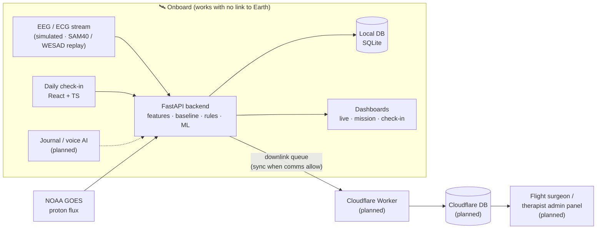

# 🛰️ EVAde · Crew Health Monitor

**NASA Space Apps Challenge 2026 · NYU Tandon · Team EVAde**

> On long missions, astronauts carry much of the responsibility for spotting health changes in themselves. EVAde is an onboard health co-pilot that **collects** health indicators (EEG, ECG, vitals, sleep, mood, radiation), **compares** them with each astronaut's *own* baseline, and tells them **what to do next**, with no help from Earth needed.

**Design principle (from our whiteboard):** *we do not assume astronauts know how to assess their health.* Every alert says why it fired and gives concrete steps, and a tutorial section teaches the basics.

---

## Contents
1. [What's built](#-whats-built)
2. [Run it](#-run-it-2-minutes)
3. [Voice agent (Twilio + Grok)](#-voice-agent-twilio--grok)
4. [Architecture](#-architecture)
5. [Datasets & data sources](#-datasets--data-sources)
6. [Key numbers for the pitch](#-key-numbers-for-the-pitch)
7. [Team & task list](#-team--task-list)
8. [Ideas & roadmap](#-ideas--roadmap)
9. [Open questions](#-open-questions)
10. [Repo layout](#-repo-layout)
11. [Limitations](#%EF%B8%8F-honest-limitations)
12. [Sources](#-sources)

---

## ✅ What's built

| Page | URL (local) | What it does |
|---|---|---|
| **Live monitor** | `http://localhost:8000` | Simulated live EEG (4 ch) + ECG at 256 Hz → stress, fatigue and heart-rhythm scores vs. a **personal baseline** → green / yellow / red alerts with actions. "Send to flight surgeon" on any alert. Demo buttons: Calm, Stress, Fatigue, Arrhythmia |
| **Daily check-in** (React + TypeScript) | `http://localhost:8000/checkin/` | Astronaut enters blood pressure, temperature, blood sugar, sleep, mood and symptoms. Checked against reference ranges **and** their own history. Saved locally (SQLite). Flight-surgeon **downlink queue** with comms modes: Online (ISS), Mars 20-min delay, Blackout |
| **Mission trends** | `http://localhost:8000/mission` | 180-day mission (ISS or Mars transit, exercise on/off) built from **published NASA data**: radiation, bone, sleep, HRV, blood pressure, EEG, comms delay, with insights + actions. **Live NOAA space weather** (solar radiation storm level) and radiation dose by destination |
| **Voice check-in** (Grok voice) | `http://localhost:8000/voice/` (browser mic) · or call your Twilio number (webhook `POST /voice/incoming`) | Talk with **EVAde**, a Grok realtime voice agent: asks sleep, mood 1–5, symptoms and optional BP / temperature / blood sugar → saves to SQLite → reads back **green / yellow / red** with why + what to do → can queue a message to the **flight-surgeon downlink**. The page shows a live transcript, the latest check-in card and the downlink queue. Optional `POST /voice/alert` phones someone with a red alert. See [Voice agent](#-voice-agent-twilio--grok) |

Every number on screen is labelled **backed** (from a study), **derived** (our arithmetic on a study's number) or **illustrative** (chosen for the demo), with a source link.

**Demo script (about 90 s):** live monitor → click Stress → alert + action → check-in with a bad day → red result → send to flight surgeon → Blackout keeps it queued → Mars mode transmits with a 20-min arrival → Mission trends ▶ Play on Mars transit (radiation passes 50% of the career limit) → tick **Demo storm** for an S3 solar storm alert.

**+ Voice add-on (about 20 s):** open `/voice/` → **Talk to EVAde** (or call the Twilio number on speaker) → EVAde greets you → "I slept three hours, mood two, and I've got a headache" → EVAde says **red**, explains *why* (under 4 hours hurts judgement) and gives 2 actions → "yes, send it to the flight surgeon" → "Sent to the flight surgeon now." → the check-in card turns red and the message appears in the downlink panel.

---

## 🚀 Run it (2 minutes)

Needs **Python 3.10+**. Node is only needed to *edit* the React app (the built app is included).

```bash
# in the folder that contains api/, models/, requirements.txt
pip install -r requirements.txt          # Windows: py -m pip install -r requirements.txt
uvicorn api.main:app                     # Windows: py -m uvicorn api.main:app
# open http://localhost:8000
```

**"No module named api"** means you're in the wrong folder: `cd` into the folder that has `api/` in it (`dir` / `ls` to check).

| Task | Command |
|---|---|
| Smoke test the pipeline | `python test_pipeline.py` |
| Fast-forward the live stream | `SIM_SPEED=5 uvicorn api.main:app` |
| Retrain the (placeholder) ML model | `python -m models.train` |
| Test the live NOAA feed | `python -m stream.space_weather` |
| Edit the React check-in app | `cd checkin-app && npm install && npm run dev` (http://localhost:5173, keep FastAPI running) |
| Rebuild it for FastAPI to serve | `cd checkin-app && npm run build` |

---

## 📞 Voice agent (Twilio + Grok)

Talk live with **EVAde**, an xAI Grok realtime voice agent that runs the daily check-in out loud. Two ways in, **one agent**: same instructions, voice, tools and rules.

- **🎙️ Browser (primary demo):** open **http://localhost:8000/voice/**, press **Talk to EVAde**, and use your laptop mic. No phone number needed.
- **📞 Phone:** dial a Twilio number. Needs a Twilio number (paid account), so use it once you have one.

Same design principle: every flag comes with *why* and *what to do*, and it says it's **decision support, not a medical device**.

```
Browser mic ──(WS /voice/browser, PCM16 24 kHz)──┐
                                                 ├─> api/voice_agent.py ⇄ wss://api.x.ai/v1/realtime (grok-voice-latest)
Phone ⇄ Twilio ──(WS /voice/stream, μ-law 8 kHz)─┘           │  function calls
                                                             ▼
                                  api/voice_tools.py → models/checkin_rules.py → SQLite data/evade.db
                                  (save_checkin, queue_flight_surgeon_message → downlink_queue)
```

- **One implementation:** `api/voice_agent.py` holds the persona, the xAI session config, tool handling and barge-in. `api/voice_browser.py` and `api/voice.py` only move audio.
- **Key stays on the server:** the browser talks to our FastAPI bridge, which talks to xAI, so `XAI_API_KEY` never reaches the page. (xAI also offers short-lived *ephemeral tokens* for direct browser connections; we don't need them with the bridge.)
- **Audio:** the browser captures the mic with an AudioWorklet, downsamples to **24 kHz PCM16** (`audio/pcm`, rate 24000) and plays the agent's 24 kHz PCM16 back. The phone path passes Twilio's **G.711 μ-law 8 kHz** straight through (`audio/pcmu`), with no resampling.
- **Barge-in:** when Grok's server VAD hears you start talking, the browser stops playback (Twilio gets a `clear`).
- **The page shows** a live status, a running transcript (you + EVAde), the latest check-in card (green / yellow / red, why, what to do) and the flight-surgeon downlink queue (`GET /voice/api/checkins/latest`, `GET /voice/api/downlink`).
- **Tools:** `save_checkin` (stores the check-in, returns level + reasons + actions, compares sleep and mood with your own last 7 check-ins) and `queue_flight_surgeon_message` (writes to `downlink_queue` with comms mode `online` / `mars` / `blackout`).
- **Security:** the browser WebSocket and data endpoints are **local-only** by default (requests through a tunnel are refused); set `EVADE_BROWSER_TOKEN` and open `/voice/?token=…` to allow another machine. `/voice/incoming` checks Twilio's `X-Twilio-Signature` and hands Twilio a one-time token that `/voice/stream` checks before opening an xAI session. `/voice/alert` needs `X-EVADE-Token` (or a localhost caller).
- **Stand-ins:** `models/checkin_rules.py` (standard clinical reference ranges) and the SQLite helpers in `api/voice_tools.py` are placeholders for the team's real check-in rules and storage. Repoint the two functions in `api/voice_tools.py` when that code lands. `api/main.py` here is minimal; merge its two `include_router` lines into the real one.

### Setup

1. **Keys:** an xAI API key ([console.x.ai](https://console.x.ai)). For phone mode, also a Twilio account with a voice-capable number ([console.twilio.com](https://console.twilio.com)).
2. **Env:** copy `.env.example` to `.env` and fill it in (it's git-ignored). Browser mode only needs `XAI_API_KEY`.

| Variable | Required | What it is |
|---|---|---|
| `XAI_API_KEY` | ✅ | xAI API key (sent as `Authorization: Bearer …`, server-side only) |
| `TWILIO_ACCOUNT_SID` | phone: `/voice/alert` | Twilio Account SID (`AC…`) |
| `TWILIO_AUTH_TOKEN` | phone (recommended) | Twilio auth token; turns on webhook signature checks |
| `TWILIO_PHONE_NUMBER` | phone: `/voice/alert` | Your Twilio number, E.164 (`+1…`) |
| `PUBLIC_BASE_URL` | phone | Public HTTPS URL of this server, e.g. `https://abc123.ngrok.app` |
| `XAI_VOICE` | optional | Voice name, default `eve` (others include `ara`, `rex`, `sal`, `leo`) |
| `XAI_MODEL` | optional | Default `grok-voice-latest` |
| `TWILIO_VALIDATE_SIGNATURE` | optional | `false` to skip signature checks in local testing only |
| `EVADE_COMMS_MODE` | optional | Default downlink mode: `online` (ISS), `mars` (20-min delay), `blackout` |
| `EVADE_ALERT_TOKEN` | optional | Shared secret for `POST /voice/alert` from another machine |
| `EVADE_BROWSER_TOKEN` | optional | Lets another machine use the browser page via `/voice/?token=…` |

### Run it locally (browser mode)

```bash
# Mac / Linux
python3 -m venv .venv && source .venv/bin/activate
pip install -r requirements.txt
uvicorn api.main:app --port 8000
# open http://localhost:8000/voice/
```

```powershell
# Windows (PowerShell)
py -m venv .venv; .venv\Scripts\Activate.ps1
py -m pip install -r requirements.txt
py -m uvicorn api.main:app --port 8000
# open http://localhost:8000/voice/
```

Open **http://localhost:8000/voice/** in Chrome, Edge or Firefox, press **Talk to EVAde**, allow the microphone, and start talking. Use **localhost** (browsers only allow the mic on localhost or HTTPS). **Headphones** work best; laptop speakers can echo into the mic and interrupt EVAde. Add `?crew=<name>` to keep separate baselines per astronaut.

Tests: `python -m pytest` (Windows: `py -m pytest`). They mock Twilio and xAI, so no keys are needed.

### Phone mode: expose it and point Twilio at it

Twilio has to reach your laptop over HTTPS/WSS. In a second terminal, run **one** of:

```bash
ngrok http 8000                                   # copy the https://….ngrok-free.app URL
cloudflared tunnel --url http://localhost:8000    # copy the https://….trycloudflare.com URL
```

Put that URL in `.env` as `PUBLIC_BASE_URL` and restart uvicorn. Then in the Twilio Console: **Phone Numbers → Manage → Active numbers → your number → Voice configuration → "A call comes in" → Webhook → `https://<public>/voice/incoming` → HTTP POST → Save.** Call the number.

Optional red-alert call (from the same machine):

```bash
curl -X POST http://localhost:8000/voice/alert -H "Content-Type: application/json" \
  -d '{"to": "+15551234567", "message": "EVAde red alert: crew member check-in is red."}'
```

### Voice limitations
- Needs a **live link** (internet to xAI, plus the phone network for phone mode), so it's a **ground-side or ISS channel**. On a Mars transit, the on-board check-in and on-device text-to-speech are the right path.
- **Phone mode needs a Twilio number**, which a free trial may not be able to get. **Twilio trial accounts** also play a trial notice at the start of each call and only reach **verified numbers**. Browser mode avoids all of this.
- The tunnel URL changes each time you restart a free ngrok/cloudflared tunnel: update `PUBLIC_BASE_URL` **and** the Twilio webhook.
- One-time stream tokens live in memory, so run a single uvicorn worker.
- The caller's phone number (or `?crew=` in the browser, default `browser-demo`) is the crew ID until login exists.

---

## 🧭 Architecture




**Why local-first:** a Mars signal takes **3–22 minutes one way**, and solar conjunction blocks it for about **2 weeks**. So everything is stored and assessed on board first, and a queue sends reports to Earth when the link allows.

**Health logic is a hybrid, on purpose:**
- **Rules + personal baseline** decide what's *critical* (e.g. heart rate > 130 or very irregular beats = red). They're explainable, so a flight surgeon can trust them.
- **ML models** find *patterns* (stress and fatigue states from EEG/ECG). A black-box model never decides on its own that something is critical.

---

## 📊 Datasets & data sources

### 1. Training datasets (for the EEG / ECG models)

| Dataset | What's in it | Labels | Access | Link | Status |
|---|---|---|---|---|---|
| **SAM40** | EEG from 40 people (18–25), 32 channels, 128 Hz. Stroop, arithmetic, mirror-image and relax tasks; 25 s trials × 3. EEGLAB `.mat`, raw + filtered | Self-rated stress 1–10 per task/trial (`scales.xls`) | ✅ Free, instant (check licence on Figshare) | [Figshare](https://doi.org/10.6084/m9.figshare.14562090.v1) | **Download now** |
| **WESAD** | 15 people (S2–S17, no S12). Chest: ECG, EDA, EMG, breathing, temperature @ 700 Hz. Wrist: BVP 64 Hz, EDA 4 Hz. One pickle per person | 1 baseline · 2 stress · 3 amusement · 4 meditation (ignore 0, 5–7) | ✅ Free (check licence on original site) | [UCI](https://doi.org/10.24432/C57K5T) | **Download now** |
| **DEAP** | 32 people × 40 one-minute music videos. 32-ch EEG (512 Hz) + GSR, breathing, temperature, ECG, BVP, EMG, EOG | Valence, arousal, dominance, liking 1–9 | ⚠️ Signed licence + wait for password | [QMUL](https://www.eecs.qmul.ac.uk/mmv/datasets/deap) | Skip this weekend |

Put downloads in `data/` (git-ignored). **No freely downloadable raw astronaut EEG or ECG exists**, so we train on public lab datasets and say so in the pitch.

### 2. NASA data (credibility / future work)

| Source | What's in it | Access | Link |
|---|---|---|---|
| **NASA OSDR: Inspiration4** | Omics from blood, plasma, serum, swabs, skin, stool, urine, T-cells; pre-, in- and post-flight (also OSD-570 to 575, 630, 656, 687) | Processed public; raw needs application | [OSD-569](https://osdr.nasa.gov/bio/repo/data/studies/OSD-569) |
| **NASA Life Sciences Data Archive** | De-identified astronaut + analog data since 1961; some open bed-rest datasets (UTMB Campaigns 1, 3, 11) | By request only | [NASA portal](https://www.nasa.gov/?p=900029) |
| **NASA Human Research Program evidence reports** | The published values below (bone, muscle, sleep, cardiovascular…) | Free PDFs | see [Sources](#-sources) |

### 3. Live feeds

| Feed | What it gives | Key? | URL | Used by |
|---|---|---|---|---|
| **NOAA GOES proton flux** | ≥10 MeV protons every 5 min, last 24 h → NOAA S1–S5 storm level | No | [JSON](https://services.swpc.noaa.gov/json/goes/primary/integral-protons-1-day.json) | `stream/space_weather.py` → Mission trends |
| NOAA space weather scales | Current + forecast R/S/G storm levels | No | [JSON](https://services.swpc.noaa.gov/products/noaa-scales.json) | Not yet |
| NASA DONKI SEP | Catalogue of past solar particle events | `DEMO_KEY` (free key at api.nasa.gov) | [API](https://api.nasa.gov/DONKI/SEP?startDate=2024-01-01&endDate=2024-12-31&api_key=DEMO_KEY) | Not yet (idea: storm replay) |

### 4. Reference data we collected (in this repo)

| File | Contents |
|---|---|
| [`docs/mission_trends.json`](docs/mission_trends.json) | 34 published health values + 14 mission-timeline events, each with source + evidence label |
| [`docs/radiation_data.json`](docs/radiation_data.json) | Dose rates by destination, NASA/ESA limits, solar-storm reference events, NOAA S-scale, live feed URLs |
| [`docs/research_trends.md`](docs/research_trends.md) | The research brief: findings, suggested demo storyline, caveats |

---

## 🔢 Key numbers for the pitch

### Body
| Indicator | What happens in long-duration flight | Evidence |
|---|---|---|
| **Bone** | Hip **−0.5%/month** with ARED exercise; **−1.56%/month** without. Recovery takes 6+ months | NASA Bone Evidence Report |
| **Muscle / fitness** | Calf volume −10 to −18% over ~6 months; aerobic fitness (VO2peak) −17% by day 14 | NASA Muscle & Aerobic Evidence Report |
| **Heart** | Resting HR unchanged; 24-h BP **−8/−9 mmHg**; cardiac output +41% | Norsk et al. 2015 |
| **HRV** | Dips ~day 22, recovered ~day 159 (*not* a steady decline) | Otsuka (preprint) |
| **Landing** | **60–80%** of crew fail a 10-min tilt test on landing day; standing HR +10–15 bpm | Lee et al. 2020 |
| **Sleep** | **6.1 h/night** on ISS vs 8.5 h scheduled; 75% used sleep meds; 19% of sleep periods misaligned | Barger 2014; NASA Sleep Report |
| **Brain** | Resting EEG alpha power drops after launch and stays low for weeks → **re-learn the baseline in flight** | Pusil et al. 2023 |
| **Cognition** | No overall decline; slower processing speed early in flight | Dev et al. 2024 (n=25) |
| **Immune** | **61%** of ISS crew shed latent herpesviruses (EBV 96%), mostly without symptoms | Rooney et al. 2019 |
| **Mood** | The "third-quarter slump" is **not** supported (21 Antarctic studies), so we don't claim it | Hawkes & Norris 2017 |

### Radiation
| Where | Dose per day | Evidence |
|---|---|---|
| Earth surface | ~0.008 mSv (~3 mSv/year) | measured |
| ISS | **~0.43 mSv** (Columbus module 195–360 µGy absorbed) | NASA Twins Study; DOSIS 3D |
| Mars surface | **0.64 mSv** | Curiosity RAD |
| Moon trip (Artemis I Orion) | **0.96–1.24 mSv**; 26.7–35.4 mSv for the 25.5-day mission | George et al. 2024, *Nature* |
| Mars transit | **1.84 mSv** (round-trip transit ≈ 0.66 Sv) | Curiosity RAD |
| Limits | NASA career **600 mSv**; per solar event 250 mSv; ESA career 1 Sv | NASA OCHMO |

**Solar storms:** the Sep 2017 storm gave **67.8 µGy inside the ISS vs 418 µGy on Mars** (≈6×), because Earth's magnetic field shields the ISS. In the Aug 1972 storm, an unshielded moonwalker could have received **~400 rem** vs **<35 rem** inside the Apollo capsule. NOAA storm levels: S1 ≥ 10 pfu, S2 ≥ 100, S3 ≥ 1,000, S4 ≥ 10,000, S5 ≥ 100,000 (≥10 MeV protons).

**Comms:** Mars one-way delay **3–22 min**; solar conjunction blackout **~9–16 days**.

---

## 👥 Team & task list


| Who | Tasks | Status |
|---|---|---|
| **Ryan L** | Get datasets for training & all · Cloudflare Worker + team creation · Python for space health data · README → project description | Datasets ✅ (this README) · README ✅ |
| **Ryan B** | Frontend tasks · Cloudflare DB edge functions + authentication · Login (Auth0 → Cloudflare?) · Voice AI · Journal entries → LLM (Grok) → summary of mental health state for a therapist user | |
| **Decong** | Cloudflare Worker + team creation · Python for space health data · Cloudflare DB | |
| **Daniel** | GoDaddy domain · Voice AI | |
| **Michael** | EEG, ECG · Train AI to analyze space health data (bone density, radiation, etc.) · FastAPI to send the frontend the results | Starter pipeline ✅ · real-data training ⏳ |
| **If time** | **Admin panel for therapists and doctors** | |

**Next steps for the ML side:** implement `load_real_dataset()` in `models/train.py` (SAM40 + WESAD) and report **cross-validated accuracy on real data**. The current 100% is on simulated data and is *not* a result. Write a `ReplaySource` in `stream/` to stream recordings into the live monitor.

---

## 💡 Ideas & roadmap

### Health indicators (from the board)
- **Space-health risks:** radiation, immune system changes, bone density loss, cardiovascular events, inadequate nutrition, behavioral health changes
- **Useful indicators (sensors):** blood pressure, blood sugar, heart rate, body temperature, sleep hours, mood. Plus EEG (brain) and ECG (heart) → **sleep monitoring**
- **Astronaut input is allowed:** EEG plus **pictures** (e.g. photo of a rash or cold sore, which links to virus reactivation)

### Product ideas
| Idea | Notes | Status |
|---|---|---|
| **Tutorial section** (videos) | "We don't assume astronauts know how to assess their health" | Planned |
| **Gamified to-do list for health tracking** | Split into basic and non-basic tasks | Planned |
| **Dashboard → predictions / alerts** | Dynamic charts, multiple ways to display info, **color coding** | ✅ Live + mission + check-in pages |
| **Journal + talk with AI** | AI extrapolates from journal entries (Grok) → therapist summary | Planned (Ryan B) |
| **Space voice agent (Twilio)** | Voice check-ins / alerts | ✅ Voice check-in in the browser or by phone + red-alert call (Twilio + Grok); see [Voice agent](#-voice-agent-twilio--grok) |
| **Space radiation & weather → best time for a spacewalk** | Use NOAA proton flux + forecast | Data feed ✅; prediction planned |
| **"How many days until they need to go home?"** | Project radiation vs career limit, bone loss, etc. | Radiation projection ✅ in Mission trends; full version planned |
| **Contact flight surgeon** after an illness is detected | | ✅ Downlink queue |
| **Database for tracking over time** | Local first, sync to cloud | ✅ SQLite; Cloudflare DB planned |
| **Login + OAuth** | Auth0 or Cloudflare | Planned |
| **Admin panel for therapists & doctors** | If time | Planned |

### Environments: what changes across them?
| Environment | What changes |
|---|---|
| **Space station (ISS)** | Near real-time comms; ~0.43 mSv/day; Earth's magnetic field blocks most storm protons |
| **Spacecraft (deep space)** | Highest radiation (~1–1.8 mSv/day); growing comms delay; storm shelter matters most |
| **Base on another planet (Mars)** | ~0.64 mSv/day; 3–22 min delay; ~2-week conjunction blackout; partial gravity |
| **Space rover** | Least shielding during EVA/driving → solar storm alerts matter most |

### Tools & sponsors on the board
Postgres DB · SpaceXSI (Cursor + Grok bot) · GoDaddy registry (domain) · Auth0 (OAuth / login, may be replaced by Cloudflare) · Vultr (cloud computing) · Cloudflare (Workers, DB, hosting) · Twilio (voice AI)

**Integration notes:**
- Keep the **Python FastAPI backend** as the source of truth for health logic (scikit-learn doesn't run in a Worker). A **Cloudflare Worker** can fetch or pipe its results and sync the downlink queue to a Cloudflare DB.
- Voice over Twilio needs a live link, so present it as a **ground-side or ISS channel**. For Mars, use on-device text-to-speech for alerts.

---

## ❓ Open questions

| Question | Answer so far |
|---|---|
| Wi-Fi in space? | ISS has a link to the ground; Mars has a 3–22 min delay and blackouts → **local DB first, sync to cloud** (✅ built) |
| Which measurements can be performed in space? | ECG, blood pressure, temperature, body mass, actigraphy for sleep, cognition tests, saliva/blood samples, personal dosimeters; EEG in research studies |
| Why is this exam needed? / How do spaceflight hazards affect these indicators? | See [Key numbers](#-key-numbers-for-the-pitch) and `docs/research_trends.md` |
| How do you predict critical health conditions? How do we know if something is critical? | Hybrid: rules + personal baseline decide "critical"; trained models find patterns |
| What do we do after we detect an illness? | Concrete actions in-app → **contact flight surgeon** (downlink queue) |
| Should we train an AI on NASA HRP data? | NASA raw astronaut data isn't public → train on SAM40/WESAD, use NASA HRP **published values** for trends |
| *For event leaders:* is it about being inside and outside the spacecraft? What is OpenSpace? | Ask at the event |

---

## 🗂 Repo layout

```
api/            FastAPI app (main.py), local SQLite storage
  voice_agent.py  shared Grok voice agent: persona, xAI session, tools, barge-in
  voice.py        phone (Twilio) bridge: /voice/incoming, /voice/stream, /voice/alert
  voice_browser.py browser bridge + page: /voice/, /voice/browser, /voice/api/*
  voice_tools.py  voice agent tools: save_checkin, queue_flight_surgeon_message (adapter to models/)
models/         features, baseline analyzer, actions, check-in rules, mission engine, ML training
tests/          pytest: voice routes, signature check, check-in rules, downlink queue, phone + browser bridges
stream/         simulated EEG/ECG source, NOAA space-weather feed
frontend/       live monitor + mission trends pages (vanilla JS); voice/ = browser voice check-in page
checkin-app/    React + TypeScript daily check-in (built app in dist/)
docs/           research brief, mission_trends.json, radiation_data.json, screenshots, whiteboards
data/           local DB + downloaded datasets (git-ignored)
```

---

## ⚠️ Honest limitations
- Live EEG/ECG is **simulated** or replayed from public lab datasets, not astronaut data.
- Check-in thresholds use **standard clinical reference ranges**, not spaceflight-specific ones.
- Some trend shapes and timings are **illustrative** and labelled as such in the app.
- The ML model is currently trained on simulated data; real-data accuracy is pending.
- The voice agent needs a live link (ground-side / ISS channel) and an xAI API key; phone mode also needs a Twilio number (browser mode doesn't).
- **Decision-support tool, not a medical device.**

---

## 📚 Sources
**Health:**
- [NASA Bone Evidence Report](https://ntrs.nasa.gov/api/citations/20170004597/downloads/20170004597.pdf)
- [NASA Muscle & Aerobic Evidence Report](https://ntrs.nasa.gov/api/citations/20220019338/downloads/Evidence%20report%20aerobic%20and%20muscle_FINAL%209-21-22%20Pubpress%20accepted_v2.pdf)
- [NASA Sleep Evidence Report](https://ntrs.nasa.gov/api/citations/20160003864/downloads/20160003864.pdf)
- [Barger 2014 (sleep)](https://www.eurekalert.org/news-releases/595450)
- [Norsk 2015 (heart & BP)](https://synapsesocial.com/papers/W1944333689)
- [Otsuka (HRV, preprint)](https://www.researchsquare.com/article/rs-2106983/v1)
- [Lee 2020 (landing)](https://www.frontiersin.org/article/10.3389/fphys.2020.00784)
- [Pusil 2023 (EEG)](https://www.nature.com/articles/s41598-023-34744-1.pdf)
- [Dev 2024 (cognition)](https://frontiersin.org/journals/physiology/articles/10.3389/fphys.2024.1451269/full)
- [Rooney 2019 (viruses)](https://pmc.ncbi.nlm.nih.gov/articles/PMC6374706)
- [Hawkes & Norris 2017 (mood)](https://www.cambridge.org/core/services/aop-cambridge-core/content/view/S003224741700050X)
- [Basner 2013 (Mars-500)](https://www.med.upenn.edu/uep/assets/user-content/documents/PNAS2013Basner1212646110withSupportingAppendix.pdf)
- [NASA Mars comms delay](https://science.nasa.gov/missions/mars-2020-perseverance/speaking-percys-language-how-to-talk-so-perseverance-will-listen/)

**Radiation:**
- [NASA Twins Study](https://lsom.uthscsa.edu/nephrology/wp-content/uploads/sites/38/2019/04/NASA-twin-study_Science.pdf)
- [DOSIS 3D (ISS)](https://www.swsc-journal.org/articles/swsc/pdf/2016/01/swsc160033.pdf)
- [DLR Sep 2017 storm](https://elib.dlr.de/120788/1/ME-SBA-2018-Berger-Matthi%C3%A4_et%20al-DOSIS-3D_Space%20Weather.pdf)
- [Artemis I, *Nature* 2024](https://doi.org/10.1038/s41586-024-07927-7)
- [Curiosity transit](https://phys.org/news/2013-12-scientists-publish-surface-mars.amp)
- [Curiosity surface](https://www.sciencedaily.com/releases/2013/12/131209181133.htm)
- [Mars reference mission](https://www.space.com/23875-mars-radiation-life-manned-mission.html)
- [August 1972 storm](https://www.space.com/749-bad-week-moon.html)
- [AstroRad vest](https://iafastro.directory/iac/paper/id/90503/abstract-pdf/IAC-24,A1,5,7,x90503.brief.pdf)
- [NASA radiation limits (OCHMO)](https://www.nasa.gov/sites/default/files/atoms/files/radiation_protection_technical_brief_ochmo.pdf)
- [NOAA S-scale](https://spaceweather.live/en/help/what-is-a-solar-radiation-storm)
